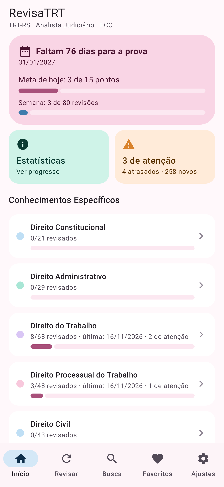
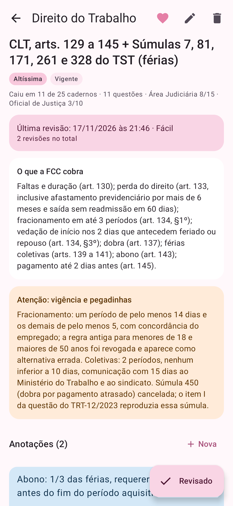
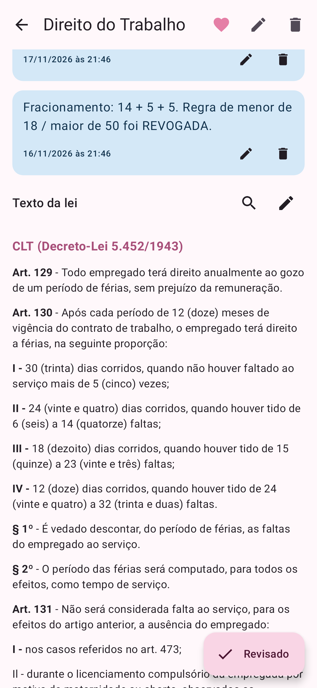
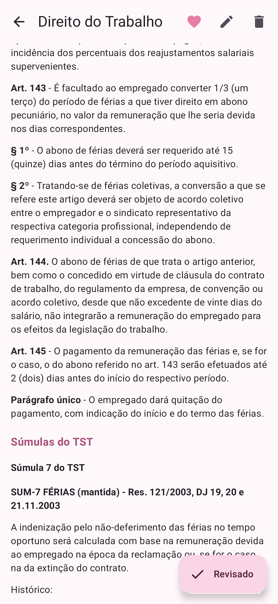
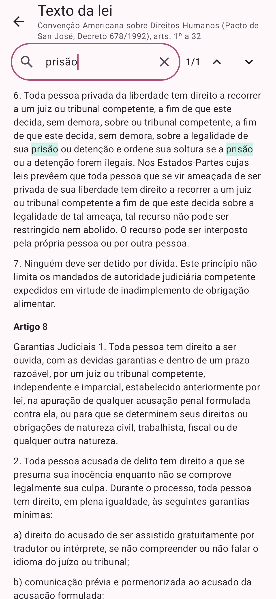
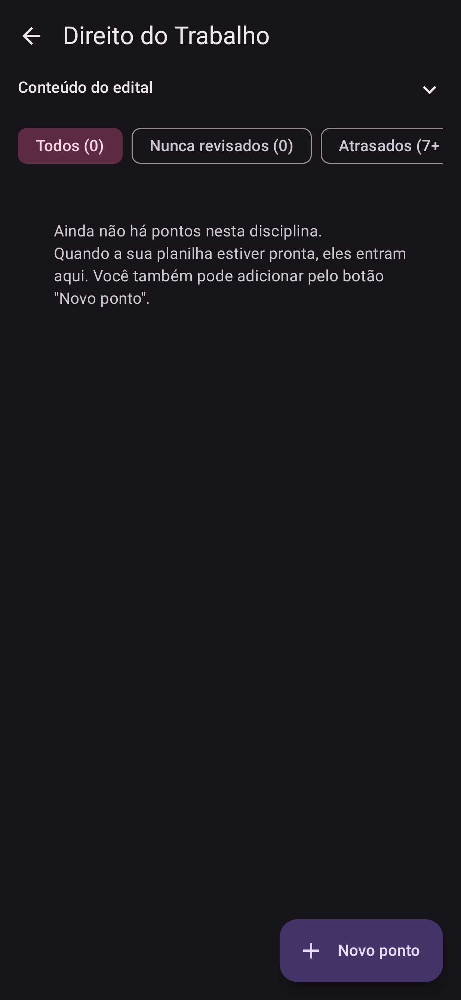

# RevisaTRT

App Android pessoal de revisão para o concurso **TRT-RS (4ª Região) – Analista Judiciário – Área Judiciária (FCC)**, prova em 31/01/2027.

<p>






</p>

## Funcionalidades

- **Disciplinas do edital** (Conhecimentos Gerais e Específicos), com o conteúdo programático.
- **Pontos por ordem de importância** (Altíssima → Não caiu), com "O que a FCC cobra", pegadinhas, vigência e onde caiu.
- **Texto da lei na íntegra** em cada ponto: artigos, incisos, parágrafos, súmulas e OJs, com busca dentro do texto.
- **Check de revisão** com avaliação Fácil / Médio / Difícil e **histórico completo**. Pontos marcados como difíceis viram **pontos de atenção**.
- **Sugestões de revisão**: pontos e disciplinas sem revisão há 7, 15 e 30 dias, e nunca revisados.
- **Anotações** por ponto (várias, com editar e apagar).
- **Favoritos** ("pontos que sempre esqueço") e **busca** ("331", "terceirização"…), inclusive dentro das anotações.
- **Estatísticas**: % revisado, sequência de dias, revisões por dia, por importância e por disciplina.
- **Lembretes** com metas diária e semanal, vários horários e dias da semana.
- **Tema claro/escuro** e cores pastel: rosa bebê, azul bebê, verde-água e roxo claro.
- **Offline**, com backup em arquivo (pode salvar no Google Drive) e backup automático do Android.

## Instalar no celular

1. Abra a página de [Releases](../../releases/latest) pelo celular e baixe o arquivo `RevisaTRT-….apk`.
2. Toque no arquivo baixado. Se o Android pedir, autorize "instalar apps desconhecidos" para o navegador/arquivos.
3. Para atualizar, basta instalar a versão nova por cima: revisões, anotações e favoritos são mantidos.

## Atualizar a base de pontos

A base fica em `dados/`:

- `dados/edital.json`: disciplinas e conteúdo programático.
- `dados/*.xlsx`: uma aba por disciplina (nome da aba = nome da disciplina ou campo `planilha` em `edital.json`), com as colunas
  `# | Dispositivo | O que a FCC cobra | Incidência | Cadernos (de 25) | Questões | Área Judiciária (de 15) | Oficial de Justiça (de 10) | Status | Atenção: vigência e pegadinhas | Onde caiu`
  e, opcionalmente, `TRF-3, TRF-4 e TJ-CE (fora da contagem)` e `Texto completo`. O "(de N)" dos cabeçalhos vira o tamanho da amostra mostrado no app.

Depois de alterar, aumente `SEED_VERSION` em `tools/gerar_seed.py` e rode:

```bash
python3 tools/gerar_seed.py
```

Textos de lei: coloque os PDFs "Vade mecum FCC TRT" em `dados/vade_mecum/` e rode `python3 tools/importar_textos.py` antes do `gerar_seed.py`. Cada seção "N. Título" do PDF vira o texto do ponto N da aba correspondente. Normas oficiais inteiras (ex.: Regimento Interno) vão em `dados/normas/`, ligadas ao ponto em `tools/importar_normas.py`; rode `python3 tools/importar_normas.py` também.

O app incorpora pontos novos e atualiza os que você não editou, sem apagar seu progresso.

## Desenvolvimento

Kotlin + Jetpack Compose + Room. `./gradlew assembleDebug` gera um APK de teste; `./gradlew testDebugUnitTest` roda o teste que percorre as telas e salva capturas em `docs/capturas/`. Cada push na `main` gera um APK assinado pelo GitHub Actions e publica uma Release.
